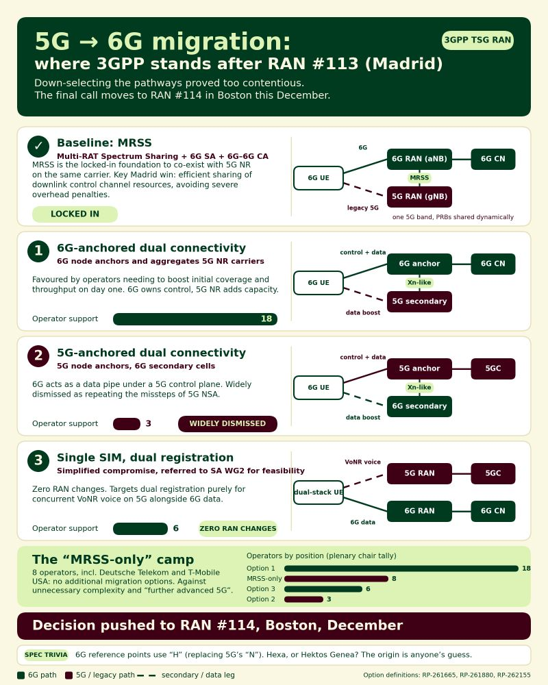

# MRSS(Multi RAT Spectrum Sharing) bottleneck with UL Capacity
MRSS is used for easy migration from 5G to 6G SA before full 6G Standardiztion.
Consider MRSS is pre-6G and pre-Commercial delivery for field trial and to operator. 
So, before deploying MRSS in site the operator benefits, bottlenecks, risk and performance are need to be investigated and analysed for both 5G and 6G users. 

